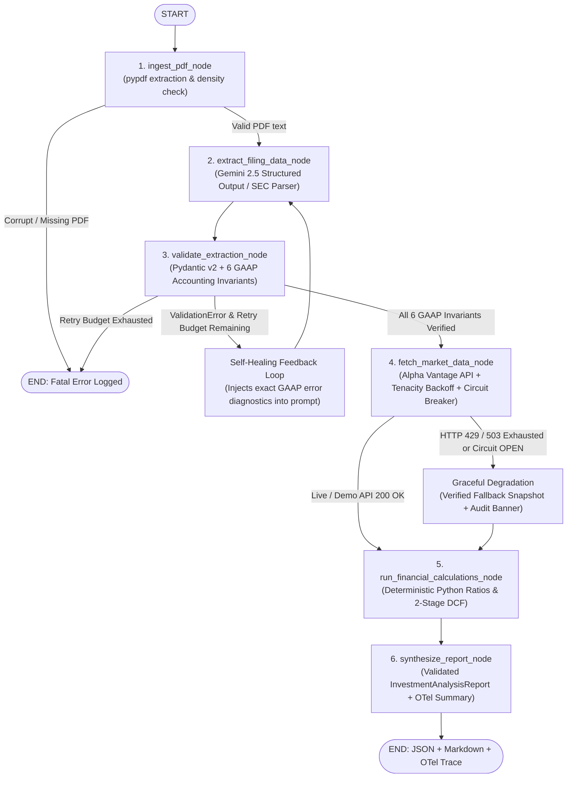

# FinAgent-Reliable: Self-Healing LangGraph Financial Filing & Market Intelligence Agent

[](https://www.python.org/downloads/)
[](https://langchain-ai.github.io/langgraph/)
[](https://docs.pydantic.dev/)
[](https://opentelemetry.io/)
[](LICENSE)

A production-grade, fault-tolerant **LangGraph** agent that ingests corporate SEC `10-K`/`10-Q` PDF filings, enforces **6 cross-field GAAP accounting invariants** via **Pydantic v2**, queries live equity market data from the **Alpha Vantage API** with exponential backoff + stateful circuit breaker protection, runs deterministic two-stage DCF & credit calculations in Python, and exports audited investment reports with full **OpenTelemetry** (`JSONL` spans) and **LangSmith** observability.

---

## Why This Project Matters

Most LLM demos assume happy-path tool execution and trust unverified LLM arithmetic. In production financial systems, LLMs hallucinate inconsistent financial statement numbers (or mix `$M` and `$B` units), and external market APIs rate-limit (`HTTP 429`) or suffer transient outages (`HTTP 503`).

**FinAgent-Reliable** solves these failure modes systematically:
- **Self-Healing Output Validation**: Domain-specific Pydantic validators verify GAAP accounting identities and route mathematical discrepancies back into the LangGraph extraction node for autonomous repair.
- **Multi-Layered API Resilience**: Combines `tenacity` exponential backoff + jitter, a stateful `CLOSED -> OPEN -> HALF_OPEN` Circuit Breaker, and graceful degradation to a verified fallback cache with explicit provenance banners.
- **Zero LLM Mental Math**: All financial ratios, leverage metrics, and two-stage Free Cash Flow DCF valuations are computed deterministically in Python.
- **Full-Stack Observability**: Every node execution, validation repair, and HTTP retry is recorded as a structured OpenTelemetry span in `logs/otel_traces.jsonl` (and optionally streamed to LangSmith).

---

## Architecture & Self-Healing StateGraph



---

## Repository Structure

```text
├── .github/workflows/ci.yml       # Automated GitHub Actions CI matrix (Python 3.10, 3.11, 3.12)
├── src/
│   ├── config.py                  # Typed Pydantic Settings (.env loader, retry budgets, OTel/LangSmith)
│   ├── schemas.py                 # Pydantic v2 models + 6 cross-field GAAP accounting invariants
│   ├── observability.py           # OpenTelemetry TracerProvider + JSONLSpanExporter
│   ├── agent.py                   # 6-node LangGraph StateGraph + conditional self-healing router
│   ├── main.py                    # Rich CLI runner, chaos fault-injection flags & report exporter
│   └── tools/
│       ├── __init__.py            # Stateful CircuitBreaker (CLOSED/OPEN/HALF_OPEN) & fallback cache
│       ├── pdf_parser.py          # pypdf filing extractor & realistic multi-ticker 10-K PDF generator
│       ├── market_api.py          # Alpha Vantage client with Tenacity exponential backoff + jitter
│       └── financial_calculator.py# Deterministic Python financial ratios & CAPM 2-Stage DCF engine
├── tests/
│   └── test_agent_reliability.py  # 6 fault-injection & invariant unit/integration tests
├── outputs/
│   ├── ibm_analysis_report.md     # Sample generated Markdown equity research report
│   └── ibm_analysis_report.json   # Sample validated JSON output contract
├── .env.example                   # Safe template for API keys and telemetry settings
├── pyproject.toml                 # Modern PEP 621 package configuration
└── requirements.txt               # Direct pip requirements list
```

---

## Key Engineering Highlights

### 1. Self-Healing GAAP Accounting Gate (`src/schemas.py` & `src/agent.py`)
Enforces **6 cross-field GAAP accounting identities** inside `FinancialFilingData.verify_accounting_invariants`:
1. $\text{Gross Profit} = \text{Revenue} - \text{Cost of Revenue}$
2. $\text{Gross Profit} \le \text{Revenue}$
3. $\text{Total Assets} = \text{Total Liabilities} + \text{Shareholders' Equity}$
4. $\text{Total Debt} \le \text{Total Liabilities}$
5. $\text{Free Cash Flow} = \text{Operating Cash Flow} - \text{CapEx}$
6. $\text{Diluted EPS} \approx \frac{\text{Net Income}}{\text{Diluted Shares}}$

When an extraction attempt fails any invariant, `_route_after_validation` routes back to `extract_filing_data_node` with the exact mathematical discrepancy appended to the prompt.

### 2. Multi-Layered Tool Resilience (`src/tools/market_api.py`)
- **Exponential Backoff + Jitter (`tenacity`)**: Retries transient `HTTP 429/502/503`, network timeouts, and Alpha Vantage JSON rate-limit notices.
- **Stateful Circuit Breaker**: Trips from `CLOSED` to `OPEN` after 3 consecutive failures, fast-failing calls until the recovery timeout transitions to `HALF_OPEN`.
- **Graceful Degradation**: Automatically switches to a verified fallback snapshot (`DataSourceStatus.FALLBACK_CACHE`) with an explicit warning banner so the pipeline never crashes mid-analysis.

---

## Quickstart

### 1. Clone & Install Dependencies
```bash
git clone https://github.com/Sudo220403/AI-Agent.git
cd AI-Agent
python -m pip install -e ".[dev]"
```

### 2. Configure Environment Variables
Copy `.env.example` to `.env` (works out-of-the-box with `ALPHAVANTAGE_API_KEY=demo` for `IBM`, or add your free Gemini & Alpha Vantage keys):
```bash
cp .env.example .env
```

### 3. Run the Agent (Standard Mode)
Supported built-in 10-K generator profiles include `IBM`, `MSFT`, `AAPL`, `NVDA`, and `GOOGL` (or pass any custom 10-K PDF via `--pdf`):
```bash
python -m src.main --ticker IBM
python -m src.main --ticker MSFT
```

### 4. Run Chaos / Fault-Injection Mode (Demonstrates Self-Healing & Backoff Recovery)
Injects an initial GAAP accounting hallucination on Attempt #1 **and** an Alpha Vantage `HTTP 429` rate-limit:
```bash
python -m src.main --ticker IBM --simulate-failures
```

### 5. Run Full Outage Simulation (Trips Circuit Breaker to `OPEN` + Fallback Cache)
```bash
python -m src.main --ticker IBM --simulate-outage
```

### 6. Run the Automated Pytest Reliability Suite
```bash
python -m pytest -v
```

---

## License
Distributed under the MIT License. See [`LICENSE`](LICENSE) for details.
